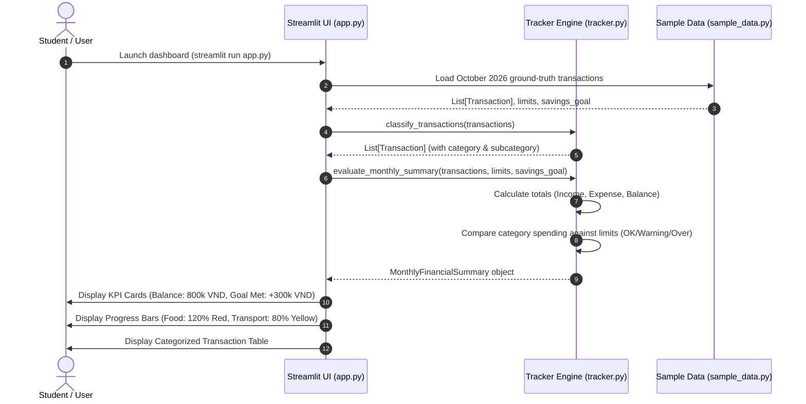
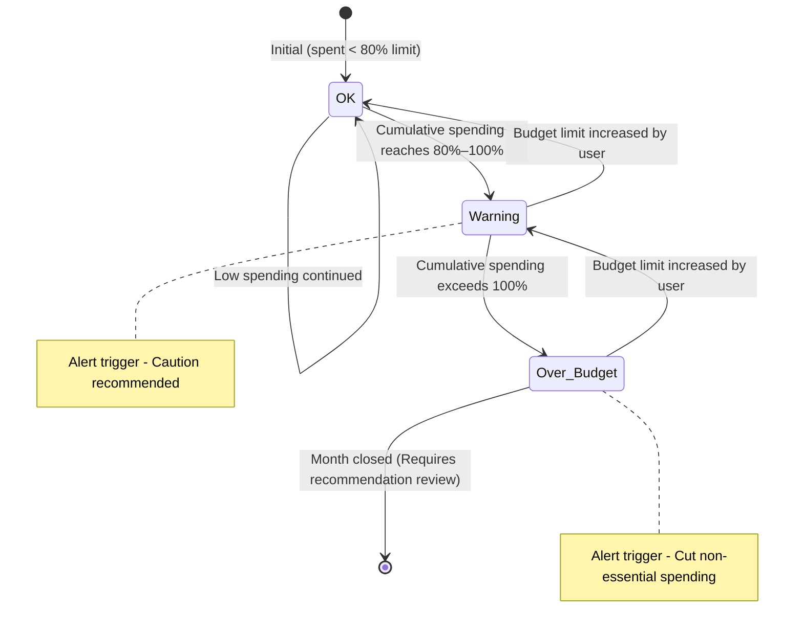
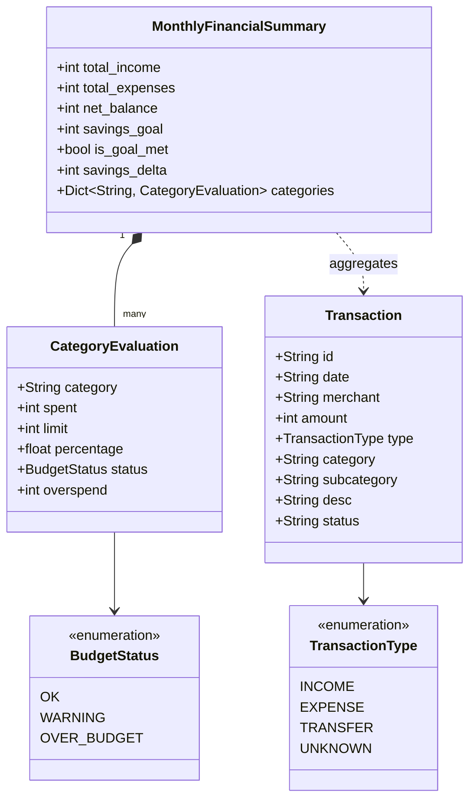

# Technical Plan & Design Artifacts: Expense Classifier & Budget Status Monitor

**Feature ID:** `FEAT-01-BUDGET-TRACKER`  
**System:** Smart Personal Finance Assistant (Group 4)  
**Author:** Hoang Thien Nhan (Student ID: 25125031)  
**Date:** November 2026  

---

## 1. System Architecture & Tech Stack

- **Programming Language:** Python 3.10+
- **Interactive UI Framework:** Streamlit (`pip install streamlit`)
- **Data Handling:** Standard Python `dataclasses` and `pandas` for tabular representation.
- **Testing:** `pytest` (or Python standard `unittest`).
- **Diagrams:** Mermaid.js (in-repo code-as-diagram).

### Directory Layout
```text
Week04/
├── .specify/
│   ├── spec.md          # Functional Requirements & User Stories
│   ├── plan.md          # Architecture, Data Models & Mermaid Diagrams
│   └── tasks.md         # Phase-by-phase implementation checklist
├── tracker.py           # Core algorithmic engine (Classification, Normalization, Budgeting)
├── sample_data.py       # October 2026 ground-truth dataset
├── app.py               # Streamlit interactive dashboard
├── test_tracker.py      # Automated verification test suite
├── README.md            # Lab 04 Development Report
├── AI_DECLARATION.md    # AI tools usage log
└── Git Commit Log.md    # Formatted Git commit trail
```

---

## 2. Data Models (Abstraction Pillar)

```python
from dataclasses import dataclass, field
from typing import Optional, List, Dict
from enum import Enum

class TransactionType(str, Enum):
    INCOME = "Income"
    EXPENSE = "Expense"
    TRANSFER = "Transfer"
    UNKNOWN = "Unknown"

class BudgetStatus(str, Enum):
    OK = "OK"
    WARNING = "Warning"
    OVER_BUDGET = "Over budget"

@dataclass
class Transaction:
    id: str
    date: str
    merchant: str
    amount: int                     # Positive VND integer
    type: TransactionType = TransactionType.EXPENSE
    category: str = "Other"
    subcategory: Optional[str] = None
    desc: str = ""
    status: str = "Confirmed"

@dataclass
class CategoryEvaluation:
    category: str
    spent: int
    limit: int
    percentage: float
    status: BudgetStatus
    overspend: int = 0

@dataclass
class MonthlyFinancialSummary:
    total_income: int
    total_expenses: int
    net_balance: int
    savings_goal: int
    is_goal_met: bool
    savings_delta: int
    categories: Dict[str, CategoryEvaluation]
```

---

## 3. Design Artifacts (Mermaid Format)

### Artifact 1: Activity Diagram (Business Flow)
Describes the end-to-end algorithmic flow from raw transaction inputs to visual warnings.

```mermaid
flowchart TD
    Start([Input: Raw Transactions & Category Limits]) --> LoopStart[For each transaction]
    LoopStart --> Normalize[Normalize text: Lowercase & Strip Vietnamese Accents]
    Normalize --> DictMatch{Match in Keyword Dictionary?}
    DictMatch -- "highlands, phuc long, cafe" --> SetCoffee[Category = Food, Sub = Coffee]
    DictMatch -- "grabfood, shopeefood" --> SetDelivery[Category = Food, Sub = Delivery]
    DictMatch -- "an trua, com, can tin" --> SetMeals[Category = Food, Sub = Meals]
    DictMatch -- "petrolimex, xang, grab bike" --> SetTransport[Category = Transport]
    DictMatch -- "fahasa, sach, hoc phi" --> SetEducation[Category = Education]
    DictMatch -- "cgv, lotte cinema, netflix" --> SetEntertainment[Category = Entertainment]
    DictMatch -- "shopee, lazada, tiki" --> SetShopping[Category = Shopping]
    DictMatch -- "No match" --> SetOther[Category = Other]
    
    SetCoffee --> CheckMore{More transactions?}
    SetDelivery --> CheckMore
    SetMeals --> CheckMore
    SetTransport --> CheckMore
    SetEducation --> CheckMore
    SetEntertainment --> CheckMore
    SetShopping --> CheckMore
    SetOther --> CheckMore

    CheckMore -- Yes --> LoopStart
    CheckMore -- No --> Aggregate[Sum spending per category & calculate net balance]
    
    Aggregate --> EvalLoop[For each category: evaluate limit]
    EvalLoop --> RatioCalc[Compute ratio: p = spent / limit]
    RatioCalc --> CheckP{Check ratio p}
    CheckP -- "p < 0.80" --> TagOK[Status: OK (Green)]
    CheckP -- "0.80 <= p <= 1.00" --> TagWarn[Status: Warning (Yellow)]
    CheckP -- "p > 1.00" --> TagOver[Status: Over budget (Red)]
    
    TagOK --> RenderDashboard[Render Streamlit Dashboard & KPI Cards]
    TagWarn --> RenderDashboard
    TagOver --> RenderDashboard
    RenderDashboard --> Finish([End])
```

---

### Artifact 2: Sequence Diagram (User & Component Interaction)
Illustrates how the frontend Streamlit dashboard orchestrates with the core calculation engine.



---

### Artifact 3: State Machine Diagram (Budget Lifecycle)
Demonstrates the state transitions of any given category's spending status during a month.



---

### Artifact 4: Class & Data Model Diagram
Visualizes the relationship between the key structural entities.



---

## 4. Edge Cases & Handling Strategy

1. **Unaccented Vietnamese:** Phrases like `"an trua"`, `"xang"`, `"hoc phi"` must match `"ăn trưa"`, `"xăng"`, `"học phí"`. The helper function `strip_accents(text)` normalizes both source and target strings using `unicodedata.normalize('NFD', ...)`.
2. **Ambiguous or Multiple Keywords:** Greedy longest-substring matching or order-of-precedence prioritization (e.g. `"grabfood"` matched before general `"grab"`).
3. **Zero Budget Limit:** Safe division with check `limit > 0` to prevent `ZeroDivisionError`.
4. **Income vs. Expense:** Income transactions (type `INCOME`) are included in total income calculation but strictly excluded from category expense totals.
