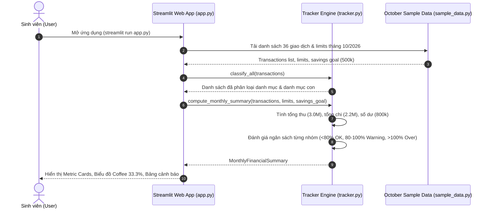
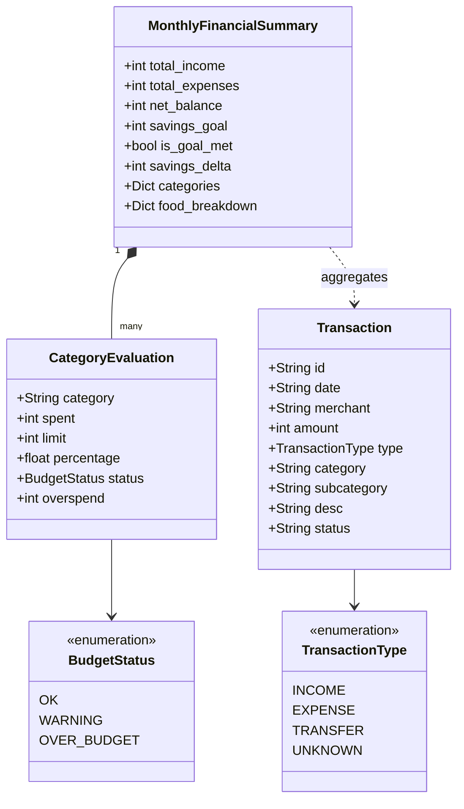

# Week 04 - Lab Report: From Spec to Code (Phased Vibe-Coding with AI)

## 1. Student & Project Information
- **Full Name:** Hoang Thien Nhan
- **Student ID:** 25125031
- **Course:** CSC10014 - Computational Thinking
- **Semester:** Semester 4
- **Project Team:** Group 4 - Smart Personal Finance Assistant
- **Feature Implemented:** **Keyword Expense Classifier & Budget Status Monitor** (`FEAT-01-BUDGET-TRACKER`)

---

## 2. Feature Overview & Computational Thinking Alignment

In our Group 4 Project Proposal (`Report.pdf` and `Slides_v2.pdf`), our system addresses the problem of scattered receipts, bank messages, and cash notes by transforming raw evidence into structured monthly insights.

For Lab 04, I selected and vibe-coded the **Stage B4 & Stage C core engine**:
1. **Decomposition:** Broken down into (1) Vietnamese text normalization & keyword dictionary matching, (2) monthly aggregation of totals, and (3) threshold-based budget evaluation.
2. **Pattern Recognition:** Recognized recurring merchant keywords (e.g., `highlands`, `phuc long` $\to$ `Food - Coffee`; `petrolimex`, `xang` $\to$ `Transport`) and spending ratios ($p = \text{spent} / \text{limit}$).
3. **Abstraction:** Ignored store logos, cashier details, and SMS balances; extracted strictly `id`, `date`, `merchant`, `amount`, and `category`. Modeled budget health using 3 discrete states (`OK`, `Warning`, `Over budget`).
4. **Algorithm Design:** Implemented deterministic $O(n)$ classification and arithmetic evaluation.

---

## 3. Spec-Driven Development with Spec Kit

Following the **Spec Kit** methodology recommended in Lab 04, development was strictly divided into five distinct, verifiable phases:

```text
Week04/
├── .specify/
│   ├── spec.md          # 1. Feature requirements, User stories, Gherkin acceptance criteria
│   ├── plan.md          # 2. Technical architecture, data models, Mermaid design artifacts
│   └── tasks.md         # 3. Step-by-step implementation checklist
├── tracker.py           # 4. Core algorithmic engine
├── sample_data.py       # 4. October 2026 ground-truth dataset from Proposal Report
├── test_tracker.py      # 4. Unit test suite verifying October figures
├── app.py               # 5. Interactive Streamlit dashboard
├── screenshots/         # 5. Screenshots of the feature running live
├── README.md            # Lab 04 Development Report
├── AI_DECLARATION.md    # AI tool usage declaration
└── Git Commit Log.md    # Chronological Git commit log
```

### Spec Kit Phases Executed:
1. **Phase 1 - Specification (`spec.md`):** Formalized user stories with Gherkin acceptance criteria and boundary constraints.
2. **Phase 2 - Technical Planning (`plan.md`):** Designed data models (`Transaction`, `CategoryEvaluation`, `MonthlyFinancialSummary`) and documented 4 Mermaid diagrams.
3. **Phase 3 - Task Breakdown (`tasks.md`):** Decomposed implementation into granular tasks with explicit git commit checkpoints.
4. **Phase 4 - Implementation & Testing:** Vibe-coded `tracker.py` and verified 100% of the ground truth using `test_tracker.py`.
5. **Phase 5 - Interactive Dashboard:** Built `app.py` in Streamlit for visual inspection and captured live screenshots.

---

## 4. Design Artifacts (Diagrams as Code with Mermaid)

### Artifact 1: Activity Diagram (Pipeline Flow)
```mermaid
flowchart TD
    Start([Input: Raw Transactions & Category Limits]) --> LoopStart[For each transaction]
    LoopStart --> Normalize[Normalize text: Lowercase & Strip Vietnamese Accents]
    Normalize --> DictMatch{Match in Keyword Dictionary?}
    DictMatch -- "highlands, phuc long, cafe" --> SetCoffee[Category = Food, Sub = Coffee]
    DictMatch -- "grabfood, shopeefood" --> SetDelivery[Category = Food, Sub = Delivery]
    DictMatch -- "an trua, com, can tin" --> SetMeals[Category = Food, Sub = Meals]
    DictMatch -- "petrolimex, xang" --> SetTransport[Category = Transport]
    DictMatch -- "fahasa, sach" --> SetEducation[Category = Education]
    DictMatch -- "cgv, netflix" --> SetEntertainment[Category = Entertainment]
    DictMatch -- "shopee, lazada" --> SetShopping[Category = Shopping]
    DictMatch -- "No match" --> SetOther[Category = Other]
    
    SetCoffee --> CheckMore{More transactions?}
    SetDelivery --> CheckMore
    SetMeals --> CheckMore
    SetTransport --> CheckMore
    SetEducation --> CheckMore
    SetEntertainment --> CheckMore
    SetShopping --> CheckMore
    SetOther --> CheckMore

    CheckMore -- Yes --> LoopStart
    CheckMore -- No --> Aggregate[Sum spending per category & calculate net balance]
    
    Aggregate --> EvalLoop[For each category: evaluate limit]
    EvalLoop --> RatioCalc[Compute ratio: p = spent / limit]
    RatioCalc --> CheckP{Check ratio p}
    CheckP -- "p < 0.80" --> TagOK[Status: OK (Green)]
    CheckP -- "0.80 <= p <= 1.00" --> TagWarn[Status: Warning (Yellow)]
    CheckP -- "p > 1.00" --> TagOver[Status: Over budget (Red)]
    
    TagOK --> RenderDashboard[Render Streamlit Dashboard & KPI Cards]
    TagWarn --> RenderDashboard
    TagOver --> RenderDashboard
    RenderDashboard --> Finish([End])
```

### Artifact 2: Sequence Diagram (User Interaction Flow)


### Artifact 3: State Machine Diagram (Budget Status Lifecycle)
```mermaid
stateDiagram-v2
    [*] --> OK: Chi tiêu < 80% hạn mức
    OK --> OK: Tiếp tục chi tiêu trong hạn mức
    OK --> Warning: Chi tiêu tích lũy đạt 80%–100%
    Warning --> Over_Budget: Chi tiêu vượt 100%
    Warning --> OK: Người dùng nâng hạn mức ngân sách
    Over_Budget --> Warning: Người dùng nâng hạn mức ngân sách
    Over_Budget --> [*]: Đóng tháng (Kích hoạt khuyến nghị tiết kiệm)
    
    note right of Warning: Cảnh báo chú ý tiết kiệm
    note right of Over_Budget: Báo động đỏ: Cần cắt giảm chi tiêu không thiết yếu
```

### Artifact 4: Class & Data Model Diagram


---

## 5. Verification Results (Ground Truth Trace)

Running `python -m unittest test_tracker.py` executes 4 test suites against the ground-truth figures:

```text
....
----------------------------------------------------------------------
Ran 4 tests in 0.002s

OK
```

### Trace Summary:
- **Total Income:** 3,000,000 VND (Matches ground truth)
- **Total Expenses:** 2,200,000 VND (Matches ground truth)
- **Net Balance:** 800,000 VND (Savings goal 500,000 VND $\to$ **Goal Achieved**, surplus +300,000 VND)
- **Food:** 1,200,000 VND / 1,000,000 VND (120.0%) $\to$ **Over budget by 200,000 VND**
  - Meals: 430,000 VND (35.8%)
  - Coffee: 400,000 VND (33.3%)
  - Delivery: 370,000 VND (30.8%)
- **Transport:** 240,000 VND / 300,000 VND (80.0%) $\to$ **Warning**
- **Education:** 250,000 VND / 400,000 VND (62.5%) $\to$ **OK**
- **Entertainment:** 220,000 VND / 300,000 VND (73.3%) $\to$ **OK**
- **Shopping:** 190,000 VND / 300,000 VND (63.3%) $\to$ **OK**
- **Other:** 100,000 VND / 200,000 VND (50.0%) $\to$ **OK**

---

## 6. Screenshots of Feature in Action

*Screenshots captured from the running Streamlit dashboard:*

### Screenshot 1: Overview & Budget Health Cards


### Screenshot 2: Food Category Deep-Dive & Actionable Advice


### Screenshot 3: Categorized Transaction Table with Filter


---

## 7. How to Run Locally

```bash
# 1. Install dependencies
pip install streamlit pandas

# 2. Run unit tests
python test_tracker.py

# 3. Launch interactive web dashboard
streamlit run app.py
```
